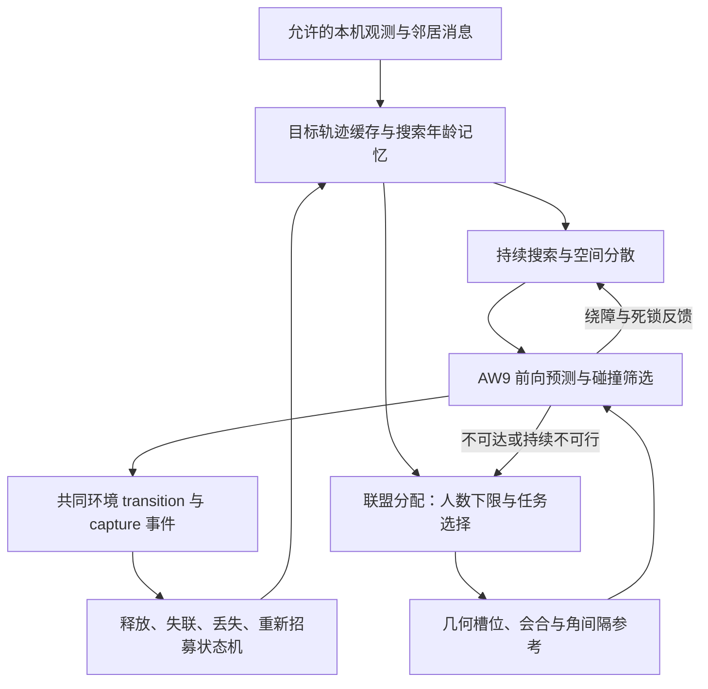

# 不使用 RL 时，CoCap 场景的传统分层系统应如何构建

日期：2026-10-17；设计版本 V3。文中“建议”“拟”均为待实现的项目方案，不能表述为任一被引论文已经完成的系统。

## 1. 先固定问题，而不是先挑控制器

标准场景为 120×120 m、12 pursuers/3 evaders/3 obstacles；小规模为 4/1/1、8/2/2。追捕者是 AW9 unicycle：每 0.5 s 选纵向加速度与角速度的 3×3 组合，物理步 0.05 s，最大速度 3 m/s，drag=0.133333…；目标最大 3.5 m/s，沿 v2_fixed APF 运动。不能为了方便把传统法改为全向瞬时速度控制，或降低目标速度。

normal capture 要求至少三架 active pursuer 在目标中心 8 m 内，环形角度最大间隙≤π，最大/最小间隙≤3；满足的 transition 立即移除目标。两机碰触、追到一定距离、绕目标群凸包或稳定跟踪都不足以计成功。碰撞必须调用同一 synchronized_swept_v1 判据。

目标/障碍观测遵循 NormSense V2 的**表面距离**过滤：R=max(20,0.8715√(A_eff/N_active))。友机 Voronoi 邻接由环境全队位置计算，是需要披露的几何信息。传统本机缓存只能来自允许的检测和实际收到的消息，不能拿 `world.evaders` 当任务清单。

来源：审计分支的 [Z05 Benchmark Contract](https://github.com/Jayyeah/cocap-voradj/blob/3038ef5cd728acdd302772ca08bf10060685af16/docs/paper/PAPER_ASSETS_20261015/PAPER_BENCHMARK_CONTRACT_DRAFT_ZH.md) §2–5。该合同仍为草案。

## 2. 推荐数据流与层间反馈

分层不是单向流水线。分配层若只按欧氏距离选人，可能把同侧三机交给目标，低层无法及时绕到另一侧；低层需要把预计会合时间、不可行槽位和失联反馈给分配层。这与 2026 TAMP 综述的 task-first/interleaved 区分有关，但这里的反馈协议是项目设计。[Tao 等综述](https://doi.org/10.1007/s10462-026-11588-5) PDF pp.3、7–9 §2.1/§3。

## 3. L1：持续搜索与空闲队员部署

### 3.1 为什么“移到 Voronoi 质心”还不够

经典 locational cost 可写为 H=Σ_i∫_{V_i}||x-p_i||²φ(x)dx，控制方向为 c_i−p_i。固定 φ 时，这主要优化传感器空间部署，达到质心后可以停止，不保证不断寻找移动或新到达目标。[Cortés 等](https://doi.org/10.1109/TRA.2004.824698)，TRA 20(2):243–255，2004；所读 [arXiv 版本](https://arxiv.org/pdf/math/0212212) PDF pp.3–5，式(6)及收敛结果。

CoCap 需要区分两项成绩：CE 是几何部署均衡；搜索是发现未知目标。为了达到 CE 而让所有人停住，会损害持续搜索，不能据此宣称传统方法天然不适合任务。

### 3.2 建议的最小可实现搜索模块

每机维护本地稀疏栅格最近观测时间 t_seen(x)。定义年龄 A_i(x,t)=min(A_max,t−t_seen(x))；新观测将本机实际可见 footprint 的年龄重置。邻居若允许分享时间戳，则仅更新收到的栅格，不能每步合并全队地图。障碍未知区与“没有目标证据”分别存储。

候选 waypoint 从可达的陈旧栅格、巡扫条带或本机局部 Voronoi 区域内生成，例如最大化

`age_reward − λ_path·travel_cost − λ_overlap·nearby_searcher_overlap − λ_switch·goal_change`。

这是**项目定义的年龄搜索评分**，不是文献官方公式。给定目标后保持若干步/直到到达以防抖动；接近零位移或重复 waypoint 时触发绕障/切换方向。局部图上不可达只取消该 waypoint，不能宣布地图已无目标。没有尚存任务时持续巡扫；没有足够局部地图时允许定时随机 waypoint 作为退化行为，报告占比。

空间分散可用局部邻居排斥和截断 Voronoi 质心作辅助，不把 CVT 静态停驻当作搜索核心。捕获全部已知目标后，SEARCH 仍继续；仅在外生评估阶段明确要求 CE recovery 时切换到部署任务。

### 3.3 搜索层替代方案

| 方法 | 适用信息条件 | 优点 | CoCap 尚缺的环节 |
|---|---|---|---|
| 重复 sweep/周期巡逻 | 已知边界；地图可局部更新 | 简单、重复访问可解释 | 障碍绕行、任务中断恢复、动态分区由项目实现 |
| 动态 φ 的 Voronoi/Lloyd | 本机年龄图与允许的友机邻接 | 与自主扩散叙事接近 | 动态密度不是原静态收敛定理；需避免质心死锁 |
| C*，TRO 2026 | 单机在线未知图；论文多机扩展集中建图/RCG | 非局部 waypoint、退路节点、覆盖孔洞补扫 | 持续年龄重访、追捕中断、局部共享、多目标围捕都需扩展 |
| Multi-CAP，2025 预印本 | bounded 未知环境、base station 全队融合 | 连通子区 + 全局 Open MDVRP + 局部覆盖 | 通信受限/非完整运动学列为未来方向；不是本地去中心化现成解 |
| LS-MCPP，TRO 2025 | 已知全局四邻接图 | 官方代码、路径均衡、PBS 冲突消解 | 图离散/覆盖 footprint/AW9 不同；动态目标与退团需额外调度 |
| HEDAC-maze，Mathematics 2026 | 集中汇集已探测迷宫图、顺序占位 | PDE 势场、已探索/未探索统一规划、源码可读 | 论文找到静止出口即结束，非持续移动目标任务；原代码许可/环境缺口 |

逐篇 PDF 页码、版本见[文献证据](TRADITIONAL_SURVEYS_AND_RECENT_METHODS_V3_ZH.md)。优先从简单且可查漏的搜索模块起步，不把不适合信息合同的大型覆盖栈强行移植。

## 4. L2：发现、跟踪与通信

目标缓存至少含 `(track_id, position_estimate, velocity_estimate, covariance_or_age, last_seen_step, source_id, version)`。初次发现先用零速度并标不确定；连续两次以上本机观测可用差分、α–β 或常速 KF。这里用常速预测是短时建模近似，不访问目标真实 APF 参数和未来轨迹。若 benchmark 原 token 提供速度，可直接使用允许字段，仍登记来源。

在本机 Voronoi 邻居或另行冻结的通信图上传播 `DETECT/TRACK/BID/COMMIT/RELEASE/LOST`。消息带 hop/TTL/sequence，队内去重；只传播经实际接收形成的任务目录。全队相连不等于瞬时全队知道目标：每个决策步最多允许的消息轮数必须固定并计费。

SPACE 可参考局部 sensing→decision→execution→exploration 的行为树接口；其原代码返回 Task/Agent 对象，已分配目标可通过共享对象读取更新。移植必须换成不可变观测快照和序列化消息，检查全任务 ID 初始化、完成标志、消息对象引用是否泄漏隐藏状态。这个修正不是运行配置开关能保证的。

`LOST` 不是 `CAPTURED`：看不见可能是出感知范围、遮挡或消息过期。只允许按共同合同提供的捕获事件，或明确的本地观测确认，发布完成 tombstone。是否由环境向全队广播捕获事件仍需冻结：若广播，则给所有方法相同事件且计作额外反馈。不能让传统法偷偷读隐藏 removed-target 集合。

## 5. L3：每目标至少三机的资源分配

### 5.1 全局版本：运输/匹配与任务激活

对已知任务集合 J，x_ij∈{0,1} 表示 i 服务 j，y_j∈{0,1} 表示激活 j。一个拟采用的分配模型为：

`min Σ c_ij x_ij + λ_switch Σ switching_ij − Σ priority_j y_j`

约束：`Σ_j x_ij≤1`，`3y_j≤Σ_i x_ij≤q_max,j y_j`，并给 SEARCH 保留可调资源。c_ij 优先包含允许信息下的路径/会合时间与绕行成本，不能只比直线距离。

若所有目标必须服务、人数需求固定，机器人到目标槽位是匹配/最小费用流结构，可用多项式算法；加入任务激活、同步会合、资源异质性等耦合后才可能成为更难的整数优化。不要把所有 MRTA 一律称 NP-hard。Hungarian 对 K×K 稠密匹配常见 O(K³)，不是整个系统的复杂度。TR-11、TR-13 的原分配公式应按其论文重建，上式只是 CoCap 架构选项。

### 5.2 局部优先：GRAPE 最小人数扩展

原文 §V 要求每任务人数 R_j；这里取 R_j=3。对人数 p<R_j 的真实效用可为零，但这样的直接偏好不满足 Single-Peaked-At-One（SPAO），因此不能只在现有 Python 评分中加个阈值就继承原定理。

论文式(28)使用辅助效用：p≤R_j 时用 dummy utility，p>R_j 时用原效用。Condition 1 要求对任意 j,k，偏好 `(j,R_j) ≻ (k,R_k+1)`；并使 p≤R_j 范围的偏好满足 SPAO。Proposition 1 在这些条件及总人数 `N≥Σ_j R_j` 下，使 Nash-stable partition 满足最低人数。论文示例可取

`u'_i(j,p)=max_k u_i(k,R_k+1)+β, p≤R_j, β>0`。

辅助效用用于组织；最终真实效益用原 u_i 评价。**“分到了三个人”仍不意味着三人已在目标附近、角间隔正确，或承诺不会被瞬时新任务打断。** 原文 [PDF p.9 §V、p.10 Proposition 2](https://arxiv.org/pdf/1711.06871)。

建议先对冻结目标快照实现该机制并验证偏好条件。在线系统再增加 epoch、任务目录版本、招募租约、最低人数确认、有限时间会合及切换滞回；这些是**项目扩展**，不能把冻结实例的收敛/近似界直接带到移动、失联、不断变化效用的执行过程。

论文基础算法为本地最优响应 + distributed mutex，邻居传播的 partition 可以扩展到全队规模。原文 p.7 §IV-A 给出 O(d_G N²) 时间步、每机每步 O(M) 搜索、O(|N_i|N) 通信量级，基于其固定实例/传播模型；不等同于 CoCap 0.5 s 内的实际 CPU 成本。全队各自知道对每项任务的偏好也是重要信息条件。

### 5.3 其他联盟层选项

- **局部贪心承诺招募**：发现者创建任务、收邻居 ETA bid、凑齐三人后 COMMIT；未齐前保持跟踪/搜索，超时解锁。每个机器人同一 epoch 只接受一个队伍，重复任务合并和冲突仲裁必须显式处理。简单、透明；无全局最优或 GRAPE 收敛保证。
- **KS-COAL 非学习骨架，RA-L 2024**：链式 coalition switching 与共识适合动态任务组织。但完整 accelerated 版含 HGAN；Scout 团队通信不受限；最终补充材料缺口及移动目标三机几何控制仍在。它保留为更重的分配层备选。
- **CBBA/CBAA**：适合独占任务/有序 bundle；SPACE 有可读实现。把目标拆成三个 slot 后若只分到两个，并不构成有效联盟；需要 all-or-none 激活与同步承诺，原 SR 任务保证不自动继承。
- **CFG-BAP，IoTJ 2026**：正式题名、MTR 和动态任务数量可核；本轮没获得全文公式/代码。作为最小人数动态分配的优先后备线索，不给它补造通信或几何能力。

当本地已知目标太多或有伤亡，`N_available<3×M_known` 时不要把所有目标各分两人。先激活可完成子集，余者排队并提升等待年龄优先级；选择可抢救目标、是否留搜索者需在 validation 上比较。12/3 情况 9 人围捕、3 人搜索只是一个初始资源方案，不能固定成所有场景最优。4/1/1 可留一名搜索者，也应允许在难例招募第四人；不得人为限制传统法资源来削弱成绩。

## 6. L4：从追上目标到几何围捕

针对联盟 C_j、m=|C_j|≥3，拟生成参考槽位：

`g_jk = p_hat_j + ρ_j [cos(θ_j+2πk/m), sin(θ_j+2πk/m)]`。

ρ_j 应小于 8 m 并大于实体碰撞所需间距，数值由合同半径与验证场景确定；不能直接把 8 m 当机器人表面距离。调整 phase θ_j 和槽位分配以减少跨越与避障；如果固定半径环穿墙/障碍，就必须报告槽位不可行并重新选择，不能假设任意目标位置都有完整可行圆环。

保序 cyclic shift 分配在平面简单情形较容易避免交换穿越；复杂遮挡可用路径成本 Hungarian，但匹配最短不自动保证无相交。先 RENDEZVOUS 到可达侧向 staging 点，再 ENCIRCLE 收缩，避免三人从同侧径直撞向目标。

一个**待验证的项目参考速度**可写为：

`v_ref,i = v_hat_j − k_r(r_i−ρ_j)e_r,i + r_i k_θ(Δ_i−Δ_prev,i)e_θ,i`。

Δ_i 是 i 到环序下一人的正向角间隙；后半项使较大前向间隙的机器人向前移动、较小间隙的减慢，意图均匀角度。m=3 的理想等间隔为 2π/3，满足 normal 的角度条件；真实离散执行仍要逐步调用官方判据。初始同角、r_i≈0、邻居丢失要单独处理，不能靠该式消除奇异性。此式仅是设计参考，**不是 OAPM、TR-11 或任何论文官方控制律**。

替换层可选：TR-11 f-gon auction+C3AVC/CLF-CBF；TR-13 leader–follower reference+CEO-DMPC；bearing/circumnavigation 或 RMPC 局部模块。选已发表完整方法时需保留其控制目标与变量定义，再单列 AW9 改造；只围绕单目标持续旋转或稳定跟踪的模块，不得称完整多目标围捕方法。

目标快于单个追捕者、转弯有界且有障碍时，可能出现根本不可达情形。多机可通过侧向包夹受益，但不能声称环形反馈在 CoCap 下全局收敛或必然捕获。

## 7. L5：AW9 执行与安全

建议优先采用同一环境动力学的有限动作前向预测：每机评估 9 个动作，每个动作展开 10 个 0.05 s 子步，累计槽位误差、角间隔偏差、动作切换、越界/碰撞风险。可扩展为两步 81 序列，先不启动联合 9^m 穷举。

筛选应覆盖**整个子步轨迹**，并使用共同的 synchronized_swept_v1 检查语义。已知邻居可用收到的意图预测，未知障碍/目标动作只用允许观测下的估计与膨胀不确定范围。预测安全不等于真实安全：未观测对象、对方转向与消息延迟均可导致碰撞。物理推进仍由统一评估器裁决。

若所有动作都预测不安全，执行预登记的最小风险动作/制动并计一次 infeasible；有限刹车距离下“紧急制动”也不保证安全，不能把不可行样本删除。预判风险只影响决策，不允许修改环境碰撞事实。

Robotarium 的 CBF-QP 与单积分器到 unicycle 映射是可靠组件参考，但原输入是连续平面速度或速度/角速度，不是有 drag 的离散加速度动作；直接量化会破坏 barrier 约束。可以比较连续控制建议经同一 AW9 选择器与直接短预测两种实现，清楚标注适配损失。SDQP 只解小型严格凸 QP，不能直接替代 TR-11 原生 LP。

## 8. L6：释放与持续任务状态机

| 状态 | 进入/行为 | 退出条件及接口 |
|---|---|---|
| SEARCH | 沿年龄 waypoint 搜索并接收任务消息 | 本机/合法消息发现任务后报名；无全局目标数 oracle |
| RECRUIT | 跟踪任务、收 bid、解决重复承诺 | 至少三名有效承诺后进入会合；lease 超时解锁 |
| RENDEZVOUS | 朝可行 staging/槽位运动 | 到位且目标估计新鲜→ENCIRCLE；不可行→重新分配 |
| ENCIRCLE | 半径与角间隔控制，持续观测更新 | 正式 capture→RELEASE；丢失→LOST；成员不足→RECRUIT |
| LOST | 按有界短预测搜索最后位置/局部扩圈 | 重发现→恢复；过期→退出任务，保留低置信度线索 |
| RELEASE | 发布允许范围内 tombstone、清空该任务承诺 | 尽快转去待服务联盟或 SEARCH；不等固定 episode 重置 |
| DEPLOY/RECOVERY | 仅当共同评估任务要求 CE 时做空间部署 | 遵循共同任务阶段；新到达观测出现时按合同响应 |

动/静目标、捕获移除、主动放弃、丢失、资源不足和任务结束必须记录不同事件。队伍内一个成员失活后，不能继续把联盟名册人数当 active 围捕人数。每次 release 记录“到首个重新搜索动作”“到下一次新目标发现”“到下一次有效三机联盟”的时间。

持续搜索与严格 CE 的切换需要任务阶段信息：若环境不向方法告知“本波已结束”，本机不能读取隐藏剩余目标数决定停搜。可由相同且预先冻结的外生阶段事件通知所有方法；否则只能使用本地任务目录/租约判断，CE 性能差别应保留，不能暗中提供 oracle。

重复到达 B/C 的历史 Z 归零触发不适用传统法。拟采用共同外生 arrival manifest，记录坐标、时间与 spawn 合法性；或另冻结所有方法共有的环境阶段触发。该新实验与历史 Z 专用协议分开命名、分开汇总。

## 9. 成本预算与可测比较

| 模块 | 能预先说的量级 | 必须实测的部分 |
|---|---|---|
| 搜索图/年龄图 | G 个本机格点的内存；局部打分常随候选数增长 | waypoint/A* 与地图交换耗时、老化策略、revisit gap |
| GRAPE | 原固定实例 O(d_G N²) 轮；每机每轮 O(M)；每机消息 O(degree_i N) | 实际轮数、partition 字节、任务变化时未收敛比例 |
| 匹配 | K 槽位稠密 Hungarian O(K³)；任务激活另计 | 整数求解状态、超时、重分配频率和切换代价 |
| 环几何 | 联盟角度排序 O(m log m)；cyclic 检查可小规模枚举 | 绕行、phase 调整、目标估计误差 |
| AW9 | 一步 9×10 子步/机器人；两步 81 序列另计 | swept 检查、预测邻居、p50/p95/p99 与超时 |

所有方法在同一硬件、线程、0.5 s 决策预算下报整队 wall-clock 与分层 CPU 时间，异步算法不能把多轮内部传播当免费瞬时通信。至少报告 normal success/完成时间、每目标等待接近、累计捕获、搜索重启、碰撞、伤亡、消息/字节、规模变化和超时/不可行率。没有证据支持预判传统法一定比 CoCap 慢。
