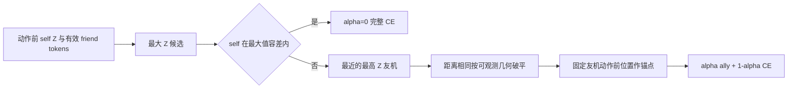
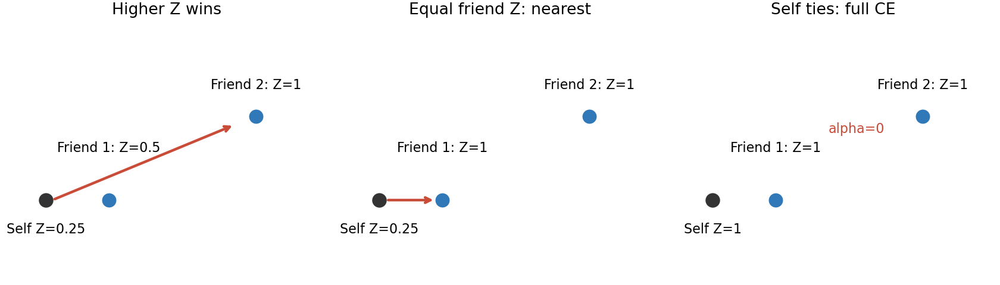
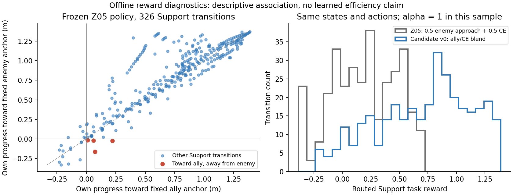

# Z-Guided Local Support v0 方法与证据指南

> 2026-10-17 更新：两臂100k warm-start及三个配对评价窗口已完成；scratch未启动。结果见[完成报告](z_guided_support_20261016/WARM_START_RESULTS_20261017_ZH.md)。下文原运行快照保留为历史记录。

日期：2026-10-16。实验分支 `experiment/iqn-z-guided-support-20261016`，基于 Z05 `f0c0dfca8a508233f30ddbb5158699400d92a00f`。**已验证 Z05 正式方法**仍由 20261015 paper 方法资料和历史独立评估定义；**Z-Guided Support 是新候选方法**，这里的工程测试和离线分析不能替代训练/held-out 结果。当前论文 Method 文件未修改。

## 为什么更换 Support 内部目标

Z05 的策略知道友机位置及 scalar Z，却不知道友机看见的敌人坐标。原 Support approach reward 恰好使用后者，因而奖励目标与 policy 输入的实体不直接一致。v0 让支持者朝实际可观测、证据最强的单架友机取得进展，检验这种训练信号是否容易从成功策略适应。友机可能移动、绕行或站在不利方向，因此“朝友机靠近”不能直接等同于“围捕更快”。

| 项目 | 已验证 Z05 | 新候选 v0 |
|---|---|---|
| Support 身份 | effective coverage 且一跳邻居为 effective capture | 保留原身份门控 |
| 内部目标 | 邻居看得见的敌人，按动作后敌距选最近者 | self + 本步 policy 实际保留的 friend tokens 中最大 Z |
| Z 同值 | 无此目标规则 | self 优先，否则最大 Z 友机中选最近；再按可观测几何破平 |
| attraction | 到隐藏敌人坐标的距离变化（敌人自身也在运动） | 自身到选中友机动作前固定锚点的进展 |
| 混合 | .5 approach + .5 CE | alpha ally + (1-alpha) CE；self 被选时 alpha=0 |
| Z / capture / ring / CE / 网络 / AW9 | 正式合同 | 均保留 |

## 观测候选与例子

友机不是按距离排序。`physical_only` 用 robot-frame 相对 x、y、友机速度 x、y、距离、角度及内部 ID 的词典序排序，再保留最多8个。v0 在 `_pack_agent_obs` 生成这些真实 token 时保存私有 ID 映射和 float32 token 快照，policy tensor、mask、类型和排序均不改变。选择器的 API 没有敌人坐标、敌人 ID 或 reward role 参数。距离比较以 policy token 的 float32 distance 为准；几何破平以该 token 前6维为准，因此“相等”也在策略实际输入精度下定义。

设 self Z=.25，可见友机 A 距离12m、Z=.5，B 距离20m、Z=1：选择 B。若 A/B 同为 Z=1，选择12m的 A。若自身也为 Z=1，选 self 并返回完整 CE。两个 Z=.5 友机分别位于相反方向、距离相同，按相对位置/速度等几何选单架；不把两者位置平均。若某个 Z=1 友机被8槽上限截断，它不能成为 v0 目标。

## 奖励公式与实现时间线

令 `C_i={i} ∪ N_i^obs`，`zmax=max(z_j)`，Z 容差 epsilon=1e-6。

- 若 `z_i >= zmax-epsilon`，选自身，alpha=0，`r_support=r_CE`。
- 否则在可见 friend 中取 `z_j >= zmax-epsilon` 的集合；最小距离 → 几何词典序 → 仅完全同特征才用稳定 ID。ID fallback 单独计数。
- 选择友机时 `alpha=z_j`，`r_ally=k*clip(||p_i^t-p_j^t||-||p_i^(t+1)-p_j^t||,-c,c)`，`r_support=alpha*r_ally+(1-alpha)*r_CE`。本配置 k=1、c=3、static capture scale=1。

step 先保存 before positions/Z/角色及已经打包的 token 映射，再移动和检查碰撞，计算 reward，处理 capture event 与 CE phase reset，随后同步更新一次 Z 并返回 next observation。友机动作后位置不进入 ally progress。失活或非有限 token 不参与选择；选定锚点若失活/非有限则 fail closed。

CE 公式不变，混合时用动作前 `w=1-alpha` 乘完整 CE（包括 PBRS）。`ce_reward_scales` 保存本步实际 w，捕获阶段边界与 terminal correction 使用同一个 w，且同一步最多消项一次。w=0 时没有 CE potential 需要消项。动态加权整体一般不再是固定 potential 的望远镜和，不能将 v0 混合公式表述成策略不变的 PBRS。

## 多目标和正常短时记忆

Z05 仍使用 `max(direct, .5*previous_self, .5*previous_neighbor_max)`，小于 .1 清零。所有直接敌情消失后全队 peak 按 `1 → .5 → .25 → .125 → 0` 衰减，0.5s 一步，约2s。捕获目标不触发额外 Z 清零。若另一目标仍可见，它继续产生 direct=1 并传播；其他机器可以保留来自已消失来源的短时记忆。全部目标捕获后，原环境直接路由到 post-capture CE，残留 Z 不会延长 Support reward。

二/三跳 Z 已通过同步更新测试；原 support role 只认一跳 effective capture 邻居，因此远端 Z 可进入 policy，却不一定激活新 Support。此限制本轮保留，不能把当前实验称为“全队连续 Z 路由”。

## 已完成的小规模工程和离线证据

64项组合测试通过（包含30个新测试实例）；T0 用2个固定 seed ×3个场景、每条最多80决策的固定动作逐 transition 比较，所有旧 key、observation、reward 分量、CE、terminal/done、Z、capture event、transition/replay metadata 一致，只增加日志。真实 normal capture 的 phase/terminal reset、双目标来源、8-token 截断、失活、几何 tie 与自然衰减均覆盖。测试输入/预期/实际见同目录的测试矩阵与回执。

两臂 diagnostic optimizer smoke 各16个决策、15次真实更新、15次 target sync，loss 有限，checkpoint/full resume/token 映射恢复成功。tiny smoke 使用专门的小 replay/batch，**不是**正式 pilot 训练合同，且其16步没有产生两臂奖励差异；不能据此判断候选有效性。

T2 先将冻结的历史 Stage1 selected policy 固化成15条轨迹（capture/mixed/coverage 各5，seed 基数2026101700，各场景偏移1000），再在独立环境中读取同一归档动作重算两种奖励。9,636个 active agent-transitions，物理轨迹/observation/capture/Z 相同；不是改变 reward 后重新学习的比较。

| 诊断 | 实际值 |
|---|---:|
| 有效 Support 转移 | 326 |
| self-tie / friend-tie | 0/326；241/326=73.93% |
| stable ID fallback | 0 |
| Support 目标切换 | 5/326=1.53%（相邻有效 Support 记录口径） |
| alpha | 全部1；本样本 v0 Support CE 权重全为0 |
| ally approach 原始均值 / 原始完整 CE 均值 | .7093 / -.3956 |
| 旧加权 Support attraction / CE 均值 | .3923 / -.1978 |
| 新加权 Support attraction / CE 均值 | .7093 / 0 |
| 自身朝友机推进却远离动作前最近敌人 | 4/309=1.29% |
| ally / 固定敌人锚点进展 Pearson 相关 | .8866 |
| 可见邻居 Z 非零但 reward role 非 Support | 1959/2285=85.73% |
| 其中 role 纯 Coverage | 78/2285=3.41%（其余主要为 Capture） |
| 高 Z 被 cap 截断 | 0（4P场景）；截断由单元测试专门覆盖 |

高 friend-tie 说明最近同 Z 友机选择确有使用场景。self-tie 在本样本没有退化为纯 CE，暂不提出必须执行 friend-first 消融；如后续正式样本大量出现，再单列消融，不混入主线。alpha 全为1则是当前旧角色门控的重要后果：v0 在本场景实际上撤掉了 Support 内的 CE。后续结果应归因于“友机目标与动态权重的联合最小改动”，不能单独归因于 Z 传播或目标可观测性。

全角色 CE 权重审计检查9,576对相邻转移：15处产生相对旧奖励的额外权重边界残差，最大绝对值 .70597；旧/新全部权重残差最大均4.18308。全部 ledger 有限且加总正确、phase/terminal 消项一致；总奖励峰值211.85来自保留的 capture event。未见数量级爆炸，但 .706 与 ally progress 尺度可比，应在训练中继续关注，不能写成“PBRS 无影响”。

这些轨迹中的接敌、ring、碰撞等物理结果在两臂完全相同；reward 均值提高和进展相关系数均不能证明围捕效率提高。

## Paired warm-start pilot 合同与 Gate

共同起点是 Z05 Stage1 正式 selected `step_1300000.pt`，SHA256 `d35b7984d8ca03fa7b536811794578ff402e9b8ad48589e3318f2cb1077d702b`。Control/Treatment 均 fresh optimizer、fresh replay、fresh recovery pool/RNG/env/Z，只传同一 policy 权重；这是 warm-start，不是完整 state resume。训练 seed=2026101601，4P1E1O 和原 mixed/coverage 交替、网络、AW9、IQN、replay合同保留。

两臂共同采用仓库已有 warm-start 超参（Stage2 的 LR=3e-5、epsilon=.28→.05/200k）；局部训练 clock 重置，原 CE 控制权重 schedule 保留。独立 YAML 除 run_name 与 `voradj.z_guided_support_enabled` 外没有差异。25k/50k/100k留 checkpoint，每个窗口两臂 evaluation 全部完成且未触发工程告警后才可继续；本轮最多100k/arm，没有自动200k、scratch或课程 promotion。

每个窗口，capture/mixed/coverage 各50独立 episodes，场景 seed=2026102600 + 场景编号×1000 + episode index，两臂共享 seed/初态 fingerprint；argmax（固定 midpoint32）与 sample（随机32 IQN分位再取均值Q argmax，epsilon=0）分报。sample 不是 categorical actor。报告 Wilson95% 区间、完成条件下时间和失败/未完成数量，不使用 best screen checkpoint 证明提升。评估保存/恢复训练 RNG，并恢复全局配置，不改变后续 continuation 的随机状态。

捕获下降超过10个百分点或碰撞上升超过10个百分点，或有效 attraction 转移不足100，暂停两臂扩展并诊断。这是工程告警，**不是**统计非劣性证明；“未触发告警”不能写为“明确不劣于 Control”。长训状态以 registry/status/heartbeat 为准，running 不等于 Gate 完成。

## Scratch、课程与论文可用边界

只有 warm-start 出现完成的积极/可比证据后才安排 fresh-init matched control/treatment。Scratch 学习尺度应参照 Stage1 2M，不能25k/50k无 normal capture就判失败。完整课程仍为4/1/1→8/2/2→12/3/3，保留原 Stage2/3 逻辑与本线 Control/正式 Z05 参考及各 stage selection/evaluation 元数据。当前不自动花费完整课程预算。

现在可以写：候选支援目标取自 policy 实际保留的友机 tokens；Z 递推、角色门控与主体算法合同保留；实现和指定工程边界已测试。尚不能写：围捕更快、更安全、优于正式 Z05、从 scratch 达到相同能力、全课程多目标稳定提升，或完全消除了系统中全局几何信息。CE 与 Voronoi 派生量、旧角色门控和终端事件仍属于原合同。

论文 Method 候选文字（仅实验候选）：

> 在原环境 Support 角色条件满足时，支持者从自身及当前观测中实际保留的友机 tokens 选择最大 Z 实体。自身与最大值近似相等时使用完整覆盖奖励；否则选择最近的最高 Z 友机，以该友机动作前位置为固定锚点计算自身距离进展，并用其 Z 值混合支援与原 CE 奖励。所有同值由确定性可观测几何处理，只有完全相同特征才使用稳定内部索引。

该段没有性能主张，不替换当前正式 Method。是否值得完整课程，需等待 matched pilot 与独立学习确认；现有证据仅支持启动有限 pilot。

## 文件与复现入口

- `src/cocap_voradj/envs/z_guided_support.py`：纯 token 选择器、固定锚点进展。
- `src/cocap_voradj/envs/voronoi_adjacency.py`：观测内部映射、Support 分支及账本日志。
- `configs/experiments/iqn_z_guided_support_20261016/`：两臂 YAML。
- `tools/z_guided_support_20261016.py`：固定重放、PBRS审计、有限训练/配对Gate、评价、导出。
- `artifacts/2026-10-16_z_guided_support/`：测试、T2 CSV/JSON、registry、曲线和轻量状态；大型轨迹/checkpoint 保留服务器 runtime。
- `docs/experiments/z_guided_support_20261016/`：源码审计、完整 patch、代码摘录、测试输入/预期/实际及 paired pilot 回执。

## 2026-10-16 运行快照

源码启动提交 `5b885c7718071a355fd9916e4d6bfabfeecab674`。Control PID3330786 / GPU0，Treatment PID3330787 / GPU1；已启动25k→50k→100k有界执行，当前还没有完成的训练后50episode配对评价。实时回执见 `runtime_snapshot.json` 与服务器各臂 `heartbeat.json`。

截至两臂各5,000步，optimizer updates仍为0。原semantic replay要求相关类别至少3,000条，4,000步时pre_capture_cover仅402条，故早期窗口可能主要是replay填充；这不是学习失败，也不能算适应性成功。本轮保留该合同；如100k有效更新仍不足，应依据实际更新数和完成的matched评价另行记录是否扩至200k，不自动扩展。
