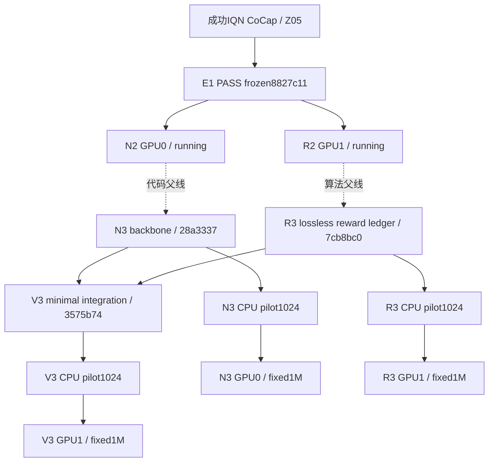

# Batch02 当前 DAG

PROVISIONAL。E1独立PASS冻结8827c11；N2/R2运行8ce5593，各1M/25k，现有worktree/作业不变。

最新授权N3→R3→V3顺序实现，各pilot1024，通过工程与原evaluator后long1M/25k。成功IQN Z05/1a9da05是唯一CoCap合同来源，无lifecycle/repeated arrival/multi-target/coverage扩展、scale/curriculum或action迁移。

| ARM | 算法parent | 代码实现SHA | 当前状态 | 核心delta |
|---|---|---|---|---|
| N3 | N2/8ce5593 | 28a3337 | 工程PASS，pilot待执行 | 原IQN feature path替换TERL representation；AW9 head/critic/PPO不变 |
| R3 | R2/8ce5593 | 7cb8bc0 | 工程PASS，pilot待执行 | 原reward六分类ledger，数值/obs/network不变 |
| V3 | N3 + R3 | 3575b74 | 集成工程PASS，pilot待执行 | native CoCap + N3 actor + R3 ledger + TERL PPO |

三线最终训练源码共用3575b74，分别固定config/hash、seed、run目录、PID、checkpoint；implementation SHA记录逐步差异，共享源码不混合训练状态。N3/R3/V3都从scratch开始，pilot不作warmstart。

N3/V3 actor3,963,913，R3 actor3,566,857；critic均3,236,865。64步provider parity、256步PPO、16步fresh-process exact resume PASS；R3/V3既有8固定mixed transition重建最大残差2.78e-17。evaluator原任务/metrics/seed域不变，pilot验证最终factory兼容。

R3≈R2、V3≈N3（新增telemetry），不能称为新reward因果证据或两次独立科学复现。实现依赖不要求N2/R2先学习成功，不追加performance gate。

现场GPU0/1各49GiB，当前各使用约1.5GiB，GPU utilization3–5%；128CPU、104GiB available RAM。pilot用CPU且线程1；long按N3→R3→V3错峰，资源不足仅降低并发。实际启动以本地runtime/per-arm progress.json为准，预登记不等于已训练。

Batch01、BASE、旧V1/M1/M2原结论与状态保留；本批不宣称最终CoCap-MAPPO成功，不自动启动其他任务。

2026-10-12 新增 [stability recovery DAG](COCAP_MAPPO_BATCH02_STABILITY_DAG_20261012_ZH.md)：三条固定500k→1M continuation，唯一变量为历史 P1 target_kl .02→.01；基线继续运行，阶段仍 PROVISIONAL。

最新状态/ETA/完整历史信号见 [2026-10-12 快速检查](BATCH02_STATUS_20261012_1655_ZH.md)。旧启动快照保留其观测时间。
