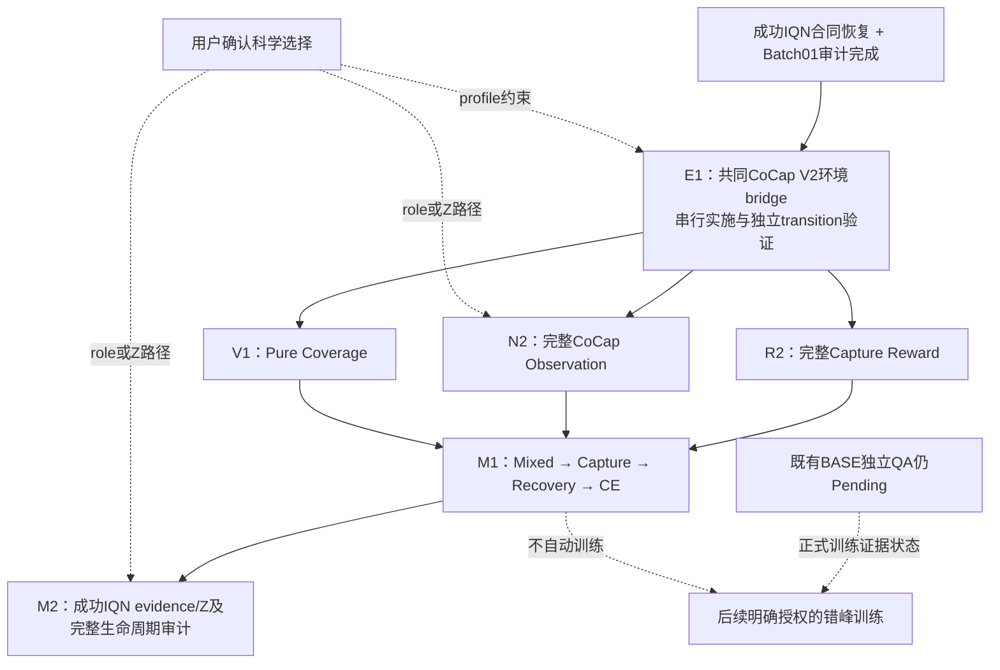

# Batch02 DAG更新

状态：第一阶段交付完成，**WAITING_NEXT_AUTHORIZATION**。E1参考fixture完成、生产bridge未实施、独立验证未完成，E1不是PASS；Batch02 training_authorized=false，未分配训练预算。

| 节点 | 现在状态 | 公共代码依赖 | 后续工作 | 训练 |
|---|---|---|---|---|
| E1 | PLAN_READY_WAITING_AUTHORIZATION | 成功IQN恢复已完成 | 串行adapter实施；同state oracle；独立bridge验证 | 不授权 |
| R2 | WAITING_E1 | E1 | E1通过后并行恢复原Capture reward consumer/组件与事件账本 | 不授权 |
| N2 | WAITING_E1 | E1 | E1通过后并行恢复完整obs；role/Z选择明示 | 不授权 |
| V1 | WAITING_E1 | E1 | E1通过后并行Pure Coverage正控准备 | 不授权 |
| M1 | WAITING_COMPONENTS | E1、R2、N2、V1 | 集成任务相位、recovery/reset/CE/clock与完整eval | 不授权 |
| M2 | WAITING_M1_AND_SCIENTIFIC_CHOICE | M1；N2的role/Z profile | 成功IQN evidence/释放与完整lifecycle；Z若N2已恢复则在此审计，不重复新增变量 | 不授权 |

本次机器DAG更新见 `artifacts/2026-09-21_ac_master_dag/state.json:batch02`。原Batch02节点全文先归档在 `artifacts/2026-10-11_cocap_mappo_batch02/dag_before.json`，再按本次用户定义改依赖。去掉T1正式规模成功、P1状态兼容、未定义representation/non-null gates、Persistent N0联合审查作为E1或Batch02准备的强制前置；它们保留为历史背景/风险信息，不新增流程门槛。既有BASE QA事实仍保留，不据自测宣称正式PASS。

执行：公共依赖串行；R2/N2/V1独立实现可并行；公共环境变更统一同步；训练错峰且只在后续明确预算内。首轮不启子Agent、不训练、不扩预算。

本轮还同步了Batch01六个engineering完成状态和R1末点screen；六个正式Batch01节点仍WAITING_BASE，未提升PROVISIONAL分类。
