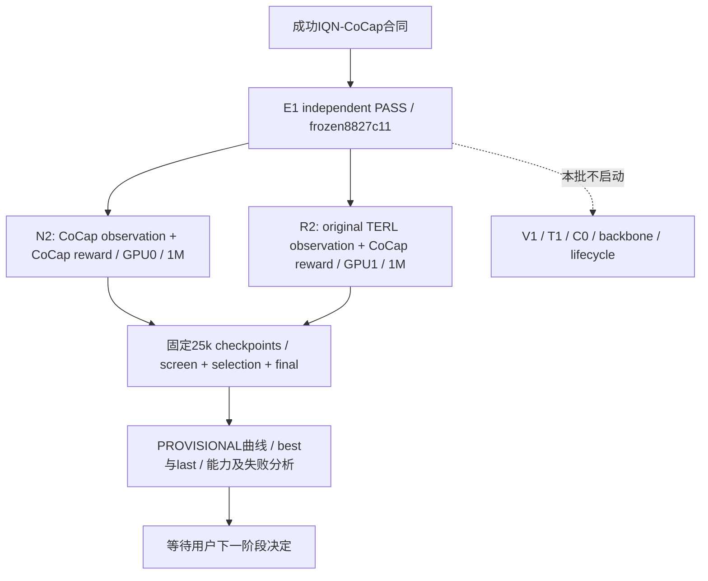

# Batch02 当前 DAG

E1 **E1_PASS_FROZEN**，固定 `8827c11`；独立 SHA/config/replay/update/resume 全部 PASS，成功 IQN-CoCap resolved hash固定，源代码不变。[独立验证](../experiments/BATCH02_E1_INDEPENDENT_VALIDATION_20261011_ZH.md)、[freeze manifest](../../artifacts/2026-10-11_batch02_e1_independent/freeze.json)。

用户授权当前 Batch02-A 进入 **PROVISIONAL capability validation**：N2/R2各1M、每25k checkpoint/evaluate、GPU0=N2/GPU1=R2。N2为TERL-MAPPO+CoCap observation+CoCap reward；R2为TERL-MAPPO+原TERL observation+CoCap reward。不是严格单变量因果实验，不启动V1/T1/C0、backbone或lifecycle。代码 `8ce5593` 与中央登记已准备，发布后错峰启动。[固定合同/计划](../experiments/BATCH02_A_CAPABILITY_PLAN_20261011_ZH.md)、[注册表](../../artifacts/2026-10-11_batch02_a_long/run_registry.json)。

| 节点 | 当前登记状态 | 合同与任务 delta | 训练授权 |
|---|---|---|---|
| E1 | E1_PASS_FROZEN | 成功 IQN V2 Z05 Stage1、固定19个源码hash | 不另开E1训练 |
| N2 | CAPABILITY_PREPARED | 沿用全CoCap obs/reward；原trainer schedule执行恢复 | 1M、25k eval、PROVISIONAL |
| R2 | CAPABILITY_PREPARED | 原TERL raw self4/19-slot view；无reward/terminal变换 | 1M、25k eval、PROVISIONAL |
| V1/T1/C0 | 当前阶段不启动 | 无新修改 | 不授权 |
| M1/M2 | 原WAITING状态保留 | 完整recovery/lifecycle/evidence迁移仍属后续任务 | 不授权 |

实际运行状态读取每线 `progress.json` 和 `/home/yjq/rl/CoCap1/batch01-commander-runtime/batch02_a_long_runtime_20261011.json`；提交内注册表是启动前固定版本，记录parent/experiment SHA、config hash、checkpoint目录与 evaluator。bounded runner完成后在同run root写每线报告及联合closeout，不自动启动下一批。

共同依赖串行，冻结环境不改；两线同一已登记代码SHA、独立进程/目录/RNG，训练错峰，周期eval在本线串行执行。不新增性能门禁、reward/architecture/curriculum tuning或预算扩展。工程检查不是学习能力结论。

先前1024步共享消费 pilot 已完成，两项consumer PASS；4个episode触边、capture=0是历史短pilot事实，不能用于本阶段学习判断。[历史结果](../experiments/BATCH02_A_N2_R2_PILOT_REPORT_20261011_ZH.md)。Batch01六线PROVISIONAL与BASE QA pending均原样保留，不作为本次新的严格前置，也不因本阶段进展升级。
