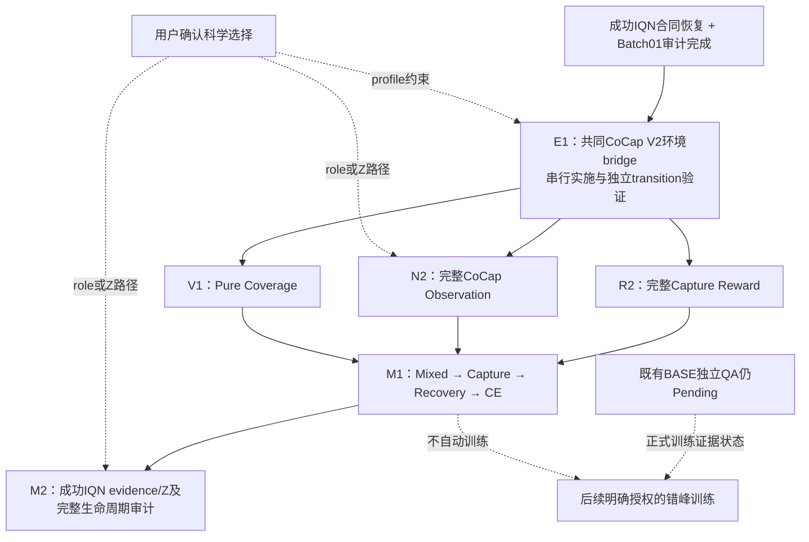

# Batch02 DAG更新

状态：**E1_ENGINEERING_CLOSED_LOOP_PASS**，生产 bridge 和有限 CPU learner 闭环已实施。用户明确授权必要输入维度/实体容量绑定，冲突以成功 CoCap 为准；原 reward/observation 设计和网络层拓扑保持。首次256步 PPO 更新和 fresh-process16步 continuation/update 全部通过。[实施报告](../experiments/BATCH02_E1_BRIDGE_REPORT_20261011_ZH.md) 与 [原始结果](../../artifacts/2026-10-11_batch02_e1/result.json)。

按第一阶段已声明的独立验证定义，**E1_PASS=false / independent_validation=false**，不是阻断 bug；不以工程自测替代独立复验，也不追加性能门禁。无长期训练授权或预算。R2/N2/V1 没有在本轮实施，无依赖的账本/源码准备可继续。

| 节点 | 现在状态 | 公共代码依赖 | 后续工作 | 训练 |
|---|---|---|---|---|
| E1 | E1_ENGINEERING_CLOSED_LOOP_PASS；独立复验未完成 | 成功IQN V2 Z05 Stage1；source `8827c11` | 代码/finite PPO/checkpoint已交付，保留独立验证缺口为warning | 有限CPU检查完成；无长期训练 |
| R2 | WAITING_E1；本轮未实施 | 固定E1 `8827c11` | 恢复完整reward组件/事件/训练clock账本；原reward已原样接入E1 | 不授权 |
| N2 | WAITING_E1；本轮未实施 | 固定E1 `8827c11` | 成功Z05完整输入已原样接入E1；后续表示评估另列，不新加roleful混合变量 | 不授权 |
| V1 | WAITING_E1；本轮未实施 | 固定E1 `8827c11` | 原coverage provider parity/CE hold通过，学习正控尚未运行 | 不授权 |
| M1 | WAITING_COMPONENTS | E1、R2、N2、V1 | 集成任务相位、recovery/reset/CE/clock与完整eval | 不授权 |
| M2 | WAITING_M1_AND_SCIENTIFIC_CHOICE | M1；N2的role/Z profile | 成功IQN evidence/释放与完整lifecycle；Z若N2已恢复则在此审计，不重复新增变量 | 不授权 |

本次机器DAG更新见 `artifacts/2026-09-21_ac_master_dag/state.json:batch02`；本轮前 E1 状态归档在 `artifacts/2026-10-11_batch02_e1/central_registration.json`。第一阶段原Batch02节点全文仍保留在 `artifacts/2026-10-11_cocap_mappo_batch02/dag_before.json`。依赖没有变化：T1正式规模成功、P1状态兼容、未定义representation/non-null gates、Persistent N0联合审查不作为E1或Batch02准备的新强制前置。既有BASE QA事实仍保留，不据自测宣称正式PASS。

执行：公共依赖串行；独立ARM可并行；公共环境变更统一同步；训练错峰且只在后续明确预算内。本轮没有子Agent或长期训练，只做已授权的有限CPU闭环。

本轮还同步了Batch01六个engineering完成状态和R1末点screen；六个正式Batch01节点仍WAITING_BASE，未提升PROVISIONAL分类。
