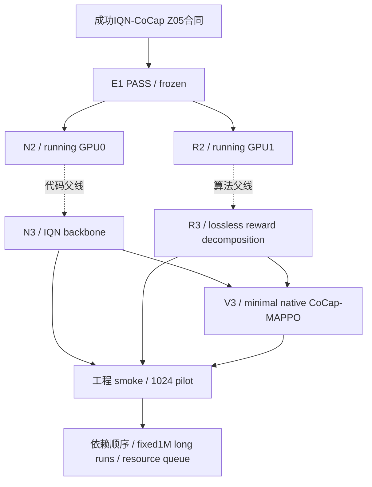

# Batch02 当前 DAG

PROVISIONAL。E1独立PASS冻结8827c11。N2/R2运行8ce5593，预算各1M/25k，保持原worktree不变。

最新授权新增N3、R3、V3，各pilot1024，工程无bug后long1M/25k。实现依赖串行，N3后R3后V3；不增加performance门禁，不启动lifecycle、repeated arrival、多target、coverage扩展、scale/curriculum或C0。

N3实现28a3337，actor3,568,137→3,963,913；critic保持3,236,865。256步PPO/64步provider parity/fresh-process resume已PASS，evaluator由pilot确认。R3/V3待顺序实施。机器登记见state.json batch02.native；旧Batch01与BASE未升级结论。

R3实现7cb8bc0，算法父线R2不改obs/network；六分类native reward ledger数值delta=0。8个既有mixed固定transition残差最大2.78e-17，64步parity/256步PPO/fresh-process resume PASS。V3待集成。
