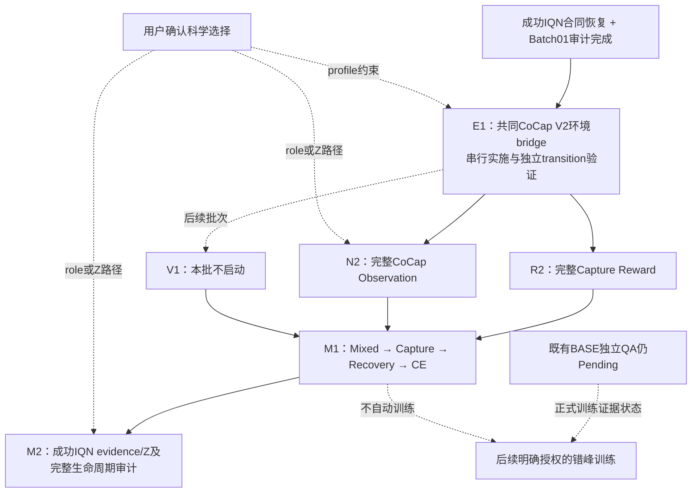

# Batch02 DAG更新

状态：**E1_PASS_FROZEN**，独立 QA 已按原五项 SHA/config/replay/update/resume 签字，固定源码 `8827c11ef3534e5e9894bfb6b223405f24544be3` 与成功 IQN resolved config hash。源代码无修改，没有增加门禁。[独立报告](../experiments/BATCH02_E1_INDEPENDENT_VALIDATION_20261011_ZH.md) 和 [freeze manifest](../../artifacts/2026-10-11_batch02_e1_independent/freeze.json)。原工程收据的 false 标记保持原样，独立签字单独归档。

Batch02-A 仅 N2/R2，用户已确认先做消费核验与短 pilot。二者完整合同在 E1 已接入，相对 E1 的 task delta 为零，不创建反事实 control、不作因果增益结论。共用1024新增 decisions、原 rollout256 / 4次 PPO / 24次 minibatch 的 CPU pilot 已完成，预算只计一次，完整 observation/reward 消费通过。4个训练 episode 触边终止、capture event=0、recovery 未触发，末尾删失。**不进入 long run**，V1/T1/C0 不启动，长期预算未授权。[计划](../experiments/BATCH02_A_N2_R2_PLAN_20261011_ZH.md) 与 [结果](../experiments/BATCH02_A_N2_R2_PILOT_REPORT_20261011_ZH.md)。

| 节点 | 现在状态 | 公共代码依赖 | 后续工作 | 训练 |
|---|---|---|---|---|
| E1 | E1_PASS_FROZEN | 成功IQN V2 Z05 Stage1；source `8827c11` | 五项独立验证通过，冻结源码/配置 | 无长期训练 |
| R2 | CONSUMPTION_QUALIFICATION_PILOT_COMPLETE | 固定E1 `8827c11` | raw reward 精确消费；四个顶层组件重构残差0，无新 reward hook | 共用1024步资格pilot完成；无长训 |
| N2 | CONSUMPTION_QUALIFICATION_PILOT_COMPLETE | 固定E1 `8827c11` | 成功 Z05 全输入精确消费；无 feature transform/query Z额外更新 | 同一pilot完成，预算不重复计；无长训 |
| V1 | DEFERRED_BY_USER_BATCH02_A | 固定E1 `8827c11` | 本批不启动 | 不授权 |
| M1 | WAITING_COMPONENTS | E1、R2、N2、V1 | 集成任务相位、recovery/reset/CE/clock与完整eval | 不授权 |
| M2 | WAITING_M1_AND_SCIENTIFIC_CHOICE | M1；N2的role/Z profile | 成功IQN evidence/释放与完整lifecycle；Z若N2已恢复则在此审计，不重复新增变量 | 不授权 |

本次机器DAG更新见 `artifacts/2026-09-21_ac_master_dag/state.json:batch02`；本轮前 E1 状态归档在 `artifacts/2026-10-11_batch02_e1/central_registration.json`。第一阶段原Batch02节点全文仍保留在 `artifacts/2026-10-11_cocap_mappo_batch02/dag_before.json`。依赖没有变化：T1正式规模成功、P1状态兼容、未定义representation/non-null gates、Persistent N0联合审查不作为E1或Batch02准备的新强制前置。既有BASE QA事实仍保留，不据自测宣称正式PASS。

执行：公共依赖串行，只有一个已授权独立 QA Agent；公共环境未改，所有 consumer 固定同一源码。pilot 在 E1 独立 PASS/冻结后运行；无 V1/T1/C0 或长期训练。既有 BASE QA pending 与 Batch01 PROVISIONAL 保留。

本轮还同步了Batch01六个engineering完成状态和R1末点screen；六个正式Batch01节点仍WAITING_BASE，未提升PROVISIONAL分类。
