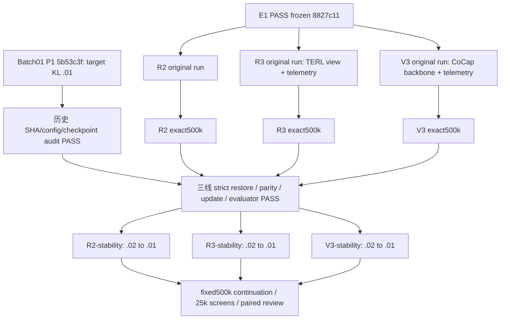

# Batch02 stability recovery DAG — 2026-10-12

状态：PROVISIONAL。历史审计、三线完整状态恢复/rollout/PPO/原 evaluator 验证 PASS；当前是待启动快照，实时进度见 runtime registry 和各 run 的 progress.json。

三线代码固定 `b479a869027262ad60bf30b0604263f5b99b5341`，历史审计提交 `6e4a4fe`。只有 PPO target_kl .02→.01，完整 Adam/ValueNorm/env/APF/RNG 恢复。原 baseline 源码及进程继续运行，未重训500k。按用户最新分配 R2/R3 使用 GPU0、V3 使用 GPU1，错峰启动后并行；保存的逻辑 CUDA RNG 原样恢复，GPU 分配记入运行元数据。旧 R2 GPU1 502304 尝试已保留/排除；正式三线仍固定原500k→1M。资源告警不新增科学门禁。

[完整合同与历史参数](../experiments/BATCH02_STABILITY_RECOVERY_20261012_ZH.md)；[实验 registry](../../artifacts/2026-10-12_batch02_stability/run_registry.json)；[原迁移 DAG](COCAP_MAPPO_BATCH02_DAG_20261011_ZH.md)。

不选择 best 作为父状态、不改 evaluator、不调 reward/network/环境。完成后比较 baseline/stability 的500k→1M曲线、550k峰值后保持、800k→1M表现及KL真实触发。暂无 A/B/C 科学结论，不自动启动下一批。
